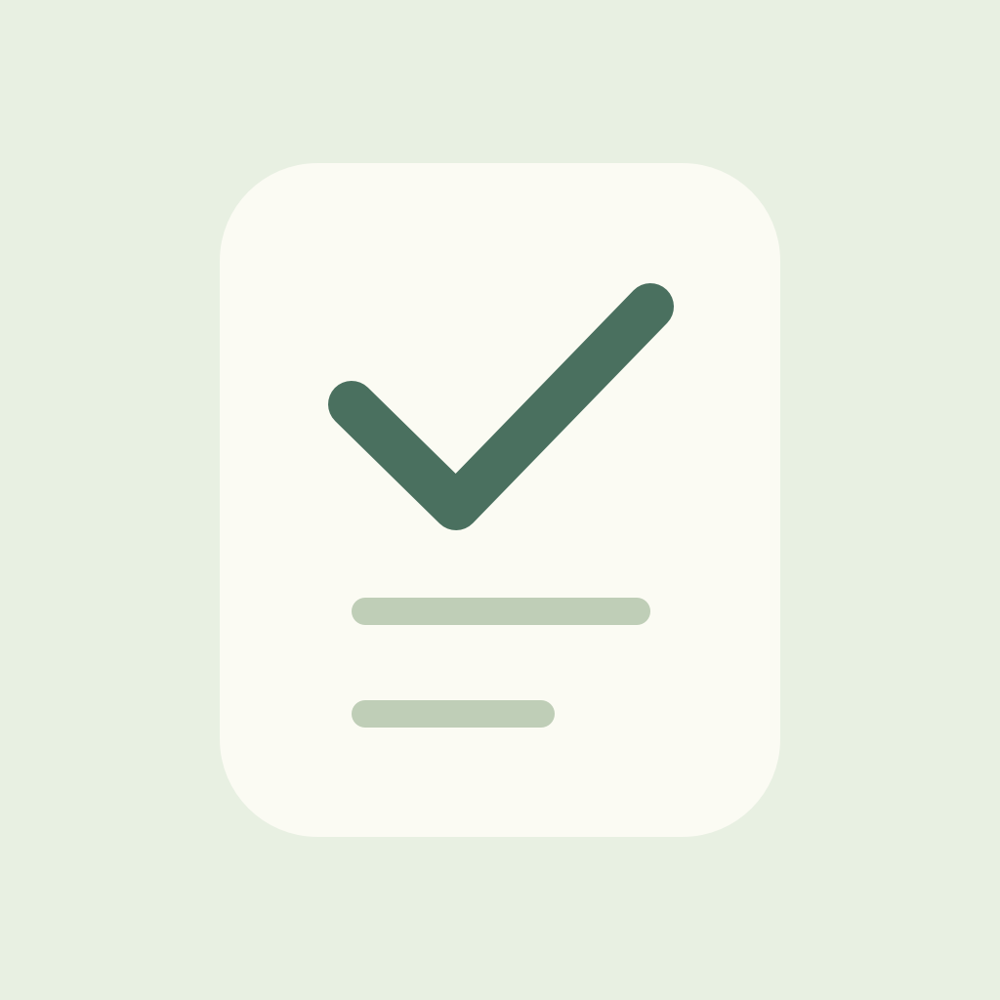
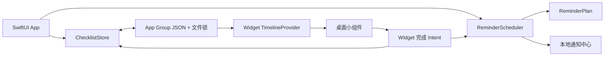

<div align="center">
  
  <h1>每日清单 · Daylist</h1>
  <p>今天做好，明天再见。</p>
  <p>原生 iOS 每日清单、定时提醒与可交互桌面小组件。</p>
  <p>
    <a href="LICENSE"></a>
    
    
    <a href="https://github.com/persistencelzx/Daylist/actions/workflows/core-tests.yml"></a>
  </p>
</div>

Daylist 是一个使用 SwiftUI、WidgetKit 和 App Intents 构建的 iPhone / iPad 清单 App。适合记录「每天吃鱼油」「读 10 页书」「睡前拉伸」这类每日事项，也支持一次性待办。

**每日事项勾选后从当天待办和小组件中隐藏，第二天自动重新出现。** 不需要每天重新创建，也不需要打开 App 才能重置完成记录。清单保存在设备本地，App 与小组件通过 App Group 共享数据。

无账号登录、无服务器、无第三方 SDK、无统计服务。

> **状态说明**：已在 Xcode 26.6 编译并签名，安装到 iPhone 14 Pro Max（iOS 26.4.1）后成功启动，使用者已确认首页正常、小组件添加成功。15 项核心 XCTest 已通过。通知送达、小组件完成操作和跨午夜刷新仍需完整真机验收，详见 [验证记录](VERIFICATION.md)。本仓库提供源码，不提供通用可安装 IPA。

## 目录

- [功能](#功能)
- [完成与重复规则](#完成与重复规则)
- [开发环境](#开发环境)
- [快速开始](#快速开始)
- [安装到自己的 iPhone](#安装到自己的-iphone)
- [桌面小组件](#桌面小组件)
- [提醒机制与限制](#提醒机制与限制)
- [架构与工程结构](#架构与工程结构)
- [数据与隐私](#数据与隐私)
- [测试](#测试)
- [归档与分发](#归档与分发)
- [常见问题](#常见问题)
- [贡献与许可证](#贡献与许可证)

## 功能

| 能力 | 说明 |
| --- | --- |
| 事项管理 | 新建、编辑、删除，支持标题、备注、SF Symbols 图标与开始日期 |
| 每日重复 | 完成当天事项后隐藏，下一当地日期重新出现在待办中 |
| 一次性事项 | 未完成时保留；完成后不再每日出现 |
| 暂停与恢复 | 暂停事项不出现在待办中，也不安排新的提醒 |
| 今日进度 | 查看完成数量，展开「今日已完成」并撤销 |
| 本地提醒 | 按事项设置小时和分钟；提前完成会取消当天待发送提醒 |
| 桌面小组件 | 支持小、中、大三种尺寸，点击圆圈完成事项 |
| 共享状态 | App 与小组件访问同一份本地数据 |
| 界面适配 | 深色模式、动态字体及基础 VoiceOver 标签 |
| 开发支持 | Xcode 双 Target 工程、共享 Scheme、核心测试及构建部署脚本 |

初次启动是空清单，不会自动写入示例任务。Widget 预览中的示例仅用于系统组件预览。

## 完成与重复规则

以每日 09:00 的「吃鱼油」为例：

1. 今天未完成时，显示在 App 和小组件的待办中。
2. 勾选后，从待办中移除，可以在 App 的「今日已完成」中找到。
3. 如果在提醒前完成，当天待发送提醒会被移除。
4. 到下一个当地日期，同一事项再次成为待办，昨天的完成记录仍被保留。
5. 撤销完成只影响当天；如果当天提醒时间尚未过去，会重新安排提醒。

重复依据**当地日期**，不是「完成之后再等待 24 小时」。持久化日期键采用当地时区下的公历 `YYYY-MM-DD`，避免设备使用其他日历时改变存储格式。

一次性事项到开始日期后会保留到完成，但它的提醒只针对计划日期安排一次，不会因逾期而每天提醒。

## 开发环境

| 项目 | 要求 |
| --- | --- |
| 运行系统 | iOS / iPadOS 17.0 或更新版本 |
| 构建工具 | 建议 Xcode 16 或更新版本；已验证 Xcode 26.6 |
| Mac 系统 | 满足所用 Xcode 版本的系统要求 |
| 模拟器 | 标准模拟器构建需要安装相应 iOS Runtime |
| 真机部署 | Apple 账号、签名团队、信任的 iPhone 和开发者模式 |
| 命令行辅助 | Bash、Python 3；部署脚本还使用 Xcode 自带的 `devicectl` 和 macOS 自带的 `sips` |
| 核心测试 | macOS 13+；Swift Package tools version 为 5.9 |

`Package.swift` 只构建 Foundation 核心库。**运行 App 请打开 `Daylist.xcodeproj`，不要将 Swift Package 当作 iOS App 打开。**

## 快速开始

### 1. 获取源码

```sh
git clone https://github.com/persistencelzx/Daylist.git
cd Daylist
```

安装完整 Xcode，首次启动并完成系统组件初始化。如果命令行仍指向 Command Line Tools，可为当前终端选择完整 Xcode：

```sh
export DEVELOPER_DIR=/Applications/Xcode.app/Contents/Developer
xcodebuild -version
```

`DEVELOPER_DIR` 不会永久修改系统全局的 Xcode 选择。

### 2. 配置自己的标识符

```sh
cp Config/Local.xcconfig.example Config/Local.xcconfig
```

编辑 `Config/Local.xcconfig`：

```xcconfig
BUNDLE_IDENTIFIER = com.yourname.daylist
APP_GROUP_IDENTIFIER = group.com.yourname.daylist
DEVELOPMENT_TEAM = YOURTEAMID
```

- `BUNDLE_IDENTIFIER`：主 App 唯一标识符，请改成自己的值。
- Widget 标识符由工程自动组合为 `$(BUNDLE_IDENTIFIER).widget`。
- `APP_GROUP_IDENTIFIER`：App 与 Widget 必须使用完全一致的共享组。
- `DEVELOPMENT_TEAM`：Xcode 中登录的开发团队 Team ID。
- `Local.xcconfig` 已被 Git 忽略，请勿提交个人签名配置。

仅进行无签名模拟器编译时，可以暂时使用工程默认标识符；若要验证 App 与 Widget 共享数据，请完成自己的 App Group 配置。

### 3. 在 Xcode 中运行

1. 打开 `Daylist.xcodeproj`。
2. 选择 **Daylist** Scheme。
3. 在 Xcode → Settings → Components 安装需要的 iOS 平台与模拟器组件。
4. 选择 iPhone 模拟器，点击 Run（⌘R）。
5. 添加第一条事项，按需要开启提醒。

无签名模拟器构建命令：

```sh
./Scripts/build.sh simulator
```

产物位于 `.build/xcode/DerivedData/Build/Products/Debug-iphonesimulator/`。该命令只构建，不会自动启动模拟器或安装 App。

## 安装到自己的 iPhone

### 签名配置

1. 在 Xcode → Settings → Apple Accounts 登录自己的 Apple 账号。
2. 填写 `Config/Local.xcconfig`。
3. 分别检查 **Daylist** 和 **DaylistWidget** Target 的 Signing & Capabilities：
   - 选择同一 Team。
   - 开启 Automatically manage signing。
   - App Groups 指向同一个 `APP_GROUP_IDENTIFIER`。
4. 若自动签名没有完成共享组注册，按 Xcode 提示处理 App ID / App Group 配置；付费开发团队也可在开发者后台手动注册。
5. 主 App 需保留 Background Modes → Background fetch；Info.plist 中的后台刷新标识由 Bundle ID 生成。

本项目曾使用 Personal Team 成功获取包含 App Group 的主 App 和 Widget 签名配置。账号能力和 Apple 策略以实际签名结果为准，可参考 [Apple 支持的能力表](https://developer.apple.com/help/account/reference/supported-capabilities-ios)。

### 手机准备

1. 用数据线连接 iPhone，解锁并选择「信任此电脑」。
2. 打开「设置 → 隐私与安全性 → 开发者模式」，按系统提示重启并确认。
3. 在 Xcode 选择该 iPhone，点击 Run。
4. 如果提示开发者尚未受信任，在「设置 → 通用 → VPN 与设备管理」中确认自己的开发者账号；按系统要求完成操作。

### 命令行一键部署

```sh
export DEVELOPER_DIR=/Applications/Xcode.app/Contents/Developer
xcrun devicectl list devices
./Scripts/deploy-device.sh <设备标识>
```

将 `<设备标识>` 替换为设备列表中的 Identifier。脚本会执行：

1. 在 `.build/device/source` 生成临时工程副本。
2. 从原始图标生成 iPhone / iPad 所需 PNG 尺寸资源。
3. 使用 iOS SDK 为 arm64 真机编译 App 和 Widget，自动请求签名更新。
4. 将 App 安装到指定设备并启动。

这条路径适用于只有 iOS SDK、模拟器 Runtime 未安装或下载失败的环境。部分 Xcode 版本的 Asset Catalog 编译会依赖可用模拟器运行时，因此脚本使用 PNG 图标资源打包本机开发版本。原始工程保留标准 Asset Catalog，App 与 Widget 的 Swift 功能代码不变。这不是 App Store 归档替代流程。

可指定构建目录：

```sh
DAYLIST_BUILD_DIR="$PWD/.build/my-device" ./Scripts/deploy-device.sh <设备标识>
```

### 免费签名与续期

免费 Personal Team 的设备安装描述文件由 Apple 设置为 **签发后 7 天到期**。到期需要重新生成签名并安装，不能通过修改工程配置延长。

保持相同 Team、Bundle ID 和 App Group 覆盖安装，通常可以保留原有数据。**不要为了续签先卸载 App**，卸载可能删除清单。如果 Xcode 缓存了即将过期的描述文件，按照 [Apple 的描述文件更新说明](https://developer.apple.com/help/account/provisioning-profiles/edit-download-or-delete-profiles/) 刷新配置后再构建。

免费账号还有 App ID、设备和安装数量限制，详见 [Apple 开发者账号说明](https://developer.apple.com/help/account/basics/about-your-developer-account/)。TestFlight 和 App Store 分发需要 Apple Developer Program 会员。

## 桌面小组件

首次启动主 App 后，在 iPhone 主屏幕长按空白区域，选择「编辑 → 添加小组件」，搜索「每日清单」。不同 iOS 版本的菜单文字可能略有不同。

| 尺寸 | 显示数量 | 内容 |
| --- | --- | --- |
| 小 | 最多 2 项 | 标题、完成按钮、待办概况 |
| 中 | 最多 2 项 | 标题、完成按钮、日期与提醒时间 |
| 大 | 最多 7 项 | 更多事项、完成按钮、日期与提醒时间 |

- 点击事项左侧圆圈完成今天的事项。
- 点击底部链接进入 App 查看更多。
- 完成全部事项后显示完成状态；空清单显示添加引导。
- 共享数据不可用时显示「打开 App 同步清单」，不会静默建立另一份独立清单。
- 系统会缓存小组件快照，刷新不是同步绘制，操作后可能稍有延迟。

Provider 会提前生成未来 7 个午夜的 Timeline Entry，并请求后续刷新。实际刷新仍由 WidgetKit 决定，不能保证午夜零秒更新。

每个完成 Intent 都携带事项 ID 和快照日期。点击昨日残留快照时，Intent 会请求刷新而不会误将今天的事项标为完成。

## 提醒机制与限制

### 为什么使用一次性通知

本项目需要「每天提醒，但完成当天事项后取消当天那一次」。重复本地通知无法通过删除某个请求单独跳过其中一天，因此 Daylist 为每个日期生成独立的本地通知。

`ReminderPlan` 从未来 **90 天范围内选择时间最近的 60 条提醒**，跨所有事项统一排序，再交给系统安排。

### 何时补充提醒

- 新建、编辑、删除、暂停或恢复事项。
- 完成或撤销完成。
- 打开 App。
- 通过小组件完成事项。
- 系统允许后台刷新时。

设置页会展示待发送提醒数量和最晚一条提醒的时间。该时间不表示那一天的所有事项都已经排入。

### 需要了解的边界

**如果长时间不打开 App、不操作小组件，且系统没有执行后台刷新，已安排的提醒耗尽后不会继续无限提醒。** 例如 10 个每日事项各有一个提醒，60 条队列大约覆盖 6 天。

- 提前完成会在重新同步时移除当天待发送提醒，并清理相应已送达通知。
- 当天提醒时间已过时，不补发过去的通知。
- 一次性事项只在其开始日期安排提醒，逾期不补发。
- 改变时区或系统时间后，打开 App 会按新的当地时间重新排程。
- 通知权限、Focus、设备关机以及系统策略会影响实际展示。
- 后台刷新属于系统尽力调度，不能承诺固定间隔执行。

如果需要「数月不打开 App 仍持续提醒，并实时跳过已完成当天事项」，需要额外实现服务端排程、远程推送和状态同步。本项目没有这套服务。

## 架构与工程结构



```text
Daylist/
├── App/
│   ├── DaylistApp.swift          # 生命周期、通知代理、后台刷新注册
│   ├── AppModel.swift            # 可观察界面状态与事项操作
│   ├── TodayView.swift           # 今日待办、进度、今日完成列表
│   ├── ItemEditor.swift          # 事项编辑与重复 / 提醒配置
│   ├── SettingsView.swift        # 提醒权限、数量和设置入口
│   ├── Assets.xcassets/          # App 图标
│   └── PrivacyInfo.xcprivacy     # 隐私清单
├── Shared/
│   ├── Core.swift               # 日期、重复规则、事项与完成状态
│   ├── Store.swift              # App Group 共享 JSON 存储
│   ├── ReminderPlan.swift       # 独立于系统通知 API 的提醒计划
│   ├── Reminders.swift          # 本地通知排程与清理
│   └── CompleteTaskIntent.swift # 小组件完成动作与过期日期保护
├── Widget/DaylistWidget.swift   # Timeline 与三种尺寸的小组件
├── Config/                     # Info.plist、权限、签名与导出设置
├── Scripts/
│   ├── build.sh                # 模拟器构建 / 归档 / 导出
│   ├── deploy-device.sh        # 真机签名、安装、启动
│   ├── prepare-device-project.py # 本机 PNG 图标打包副本
│   ├── test-core.sh            # 无 XCTest 环境的核心测试入口
│   └── PortableTestSupport.swift # 可移植断言适配层
├── Tests/DaylistCoreTests.swift # 核心行为测试
├── Daylist.xcodeproj/          # App + Widget，包含共享 Scheme
├── Package.swift               # Foundation 核心库与 XCTest
├── VERIFICATION.md             # 实际验证记录与真机验收列表
└── CONTRIBUTING.md             # 贡献指南
```

### 完成状态

每个 `ChecklistItem` 使用 `completedDays: Set<String>` 保存完成日期。读取指定日期的清单时动态计算是否完成，不会在午夜删除所有完成记录，也不依赖定时器重建事项。

### 跨进程一致性

`ChecklistStore` 通过 `flock` 保护读写，并在锁内重新读取最新 JSON。写入使用原子替换，避免半写文件。App 编辑保存时保留最新完成记录，防止编辑期间的小组件完成操作被旧界面状态覆盖。

损坏的 JSON 或较新 schema 会报错，不会被空清单静默覆盖。

### Intent 与排程

`CompleteTaskIntent` 使用 `LiveActivityIntent`，让交互在主 App 进程执行，使通知排程使用主 App 的通知中心；该实现不要求实际创建 Live Activity。

`ReminderScheduler` 使用 actor，并将并发同步请求合并为后续重算，保证最后一轮从磁盘读取较新的清单状态。

## 数据与隐私

- 事项及完成记录保存在 App Group 下的 `checklist.json`。
- `checklist.lock` 用于 App / Widget 跨进程文件锁。
- iOS 数据文件设置为首次解锁后可访问的文件保护级别。
- 提醒通知交给设备本地通知中心，不向自建服务器上传清单。
- 无 API Key、广告 SDK、用户账号或分析上报。
- 仓库不含个人签名配置、开发者证书、私钥、设备标识或用户清单。

当前没有云同步、应用内备份导出和历史统计界面。请勿将「本地存储」理解为已经实现备份；卸载、清除数据或改变 App / App Group 标识可能影响现有数据。

## 测试

在工程根目录运行真正的 XCTest：

```sh
export DEVELOPER_DIR=/Applications/Xcode.app/Contents/Developer
swift test
```

只有 Command Line Tools、缺少 XCTest 时：

```sh
./Scripts/test-core.sh
```

可移植运行器从同一份 `Tests/DaylistCoreTests.swift` 提取测试方法，使用断言适配层执行，不依赖另一套复制的业务测试。

已覆盖 15 项核心用例：

- 当天隐藏、次日恢复、重复完成幂等与当天撤销。
- 一次性事项、暂停事项和未来开始日期。
- 午夜边界、非公历设置与当地时区。
- 当天完成后的提醒移除、跨事项时间排序与 60 条限额。
- 一次性通知、过去时间不补发、关闭提醒。
- 夏令时春季跳时和秋季重复时刻。
- 40 路并发写入与持久化一致性。
- 损坏文件、较新 schema 的非破坏性错误处理。

GitHub Actions 在 macOS 上运行 `swift test` 并检查工程 / plist 格式。它不执行真机通知测试或小组件 UI 测试。

详细的实际结果与待验收项目见 [VERIFICATION.md](VERIFICATION.md)。

## 归档与分发

先配置自己的开发团队、Bundle ID 和 App Group，再运行：

```sh
./Scripts/build.sh archive
./Scripts/build.sh export
```

| 命令 | 产物 |
| --- | --- |
| `build.sh simulator` | `.build/xcode/DerivedData/` |
| `build.sh archive` | `.build/xcode/Daylist.xcarchive` |
| `build.sh export` | `.build/xcode/Export/` |
| `deploy-device.sh <设备标识>` | `.build/device/` 并安装到指定设备 |

`Config/ExportOptions.plist` 默认使用 `app-store-connect` 导出方式，需要相应会员资格和分发配置。正式归档请使用原始 Xcode 工程及正常 Asset Catalog 工具链。

TestFlight / App Store 还需要 App Store Connect 记录、正确签名、隐私问卷、真实截图和其他上架资料。脚本不会自动发布、上传或邀请测试者，本项目也未宣称已经通过 App Store 审核。

## 常见问题

### 小组件库里找不到「每日清单」

先启动一次主 App，并确认安装包包含 `DaylistWidget.appex`。如果系统列表仍未更新，重新进入组件库；必要时重启并解锁设备后再试。

### 小组件提示「共享数据暂不可用」

检查两个 Target 是否使用同一个 Team 和 App Group，并确认签名描述文件实际包含共享组能力。仅填写 Info.plist 字符串，不能替代签名权限。

### 勾选后小组件没有立即刷新

App 会请求重载 Timeline，但 WidgetKit 决定最终刷新时间。打开主 App 检查完成记录；如果手机显示昨天的快照，旧日期 Intent 会拒绝误完成今天的事项。

### 没有收到提醒

确认事项已启用提醒、开始日期有效、提醒时间尚未过去，并允许系统通知。检查设置页中的待发送数量和最晚提醒时间，以及 Focus / 系统通知设置。长期没有使用后，打开 App 补充提醒队列。

### App 一周后无法打开

免费 Personal Team 签名可能已到期。连接同一台开发 Mac，重新签名并覆盖安装。保持原 Team、Bundle ID 和 App Group，避免先卸载清单 App。

### Xcode 提示 iOS 平台未安装，或图标编译报没有模拟器 Runtime

在 Xcode → Settings → Components 安装相应平台。只需要在真实 iPhone 上本地运行时，也可使用 `Scripts/deploy-device.sh` 的 PNG 图标打包流程；它仍需要完整 Xcode 和 iOS SDK。

### 为什么没有提供 IPA 下载

安装权限与开发团队、设备和签名有关。一个开发者签名的 IPA 不代表所有 iPhone 都能安装。请使用自己的 Apple 账号构建，或自行配置合适的正式分发方式。

## 贡献与许可证

欢迎通过 [Issues](https://github.com/persistencelzx/Daylist/issues) 反馈问题或提交 Pull Request。提交前请阅读 [贡献指南](CONTRIBUTING.md)，不要上传真实清单、设备标识、签名材料或本机配置。

本项目采用 [MIT License](LICENSE)，允许使用、修改和再分发，请保留许可证及版权声明。

## Apple 官方参考

- [为小组件和 Live Activity 添加交互](https://developer.apple.com/documentation/widgetkit/adding-interactivity-to-widgets-and-live-activities)
- [配置 App Groups](https://developer.apple.com/documentation/xcode/configuring-app-groups)
- [安排本地通知](https://developer.apple.com/documentation/usernotifications/scheduling-a-notification-locally-from-your-app)
- [在模拟器或真机运行 App](https://developer.apple.com/documentation/xcode/running-your-app-on-simulated-or-physical-devices)
- [开发者账号与免费签名限制](https://developer.apple.com/help/account/basics/about-your-developer-account/)
